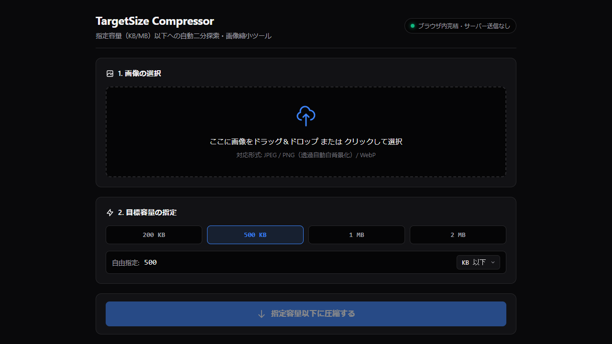
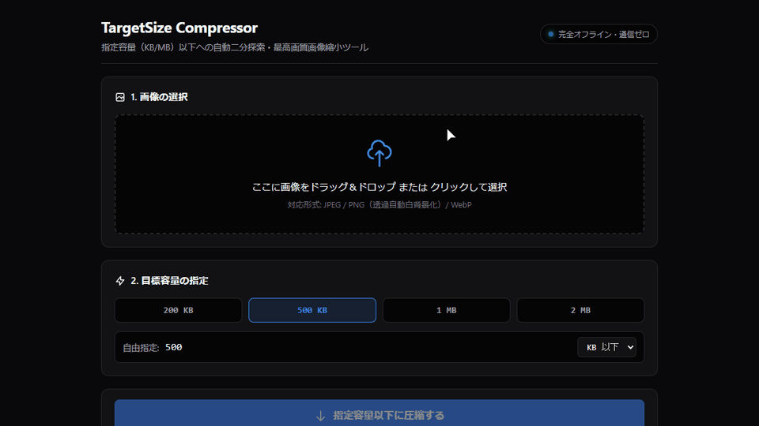

# 指定キロバイト（KB）画像縮小ツール（TargetSize Compressor）

[](LICENSE)

画像のファイルサイズを、指定した容量（KB / MB）以下にブラウザ内で縮小・圧縮するWebツールです。





---

## こんなときに

オンライン申請やエントリーシート、各種Webフォームに顔写真や書類の画像を提出するとき、「500KB以下」「2MB以下」といったファイルサイズの制限に合わせる場面で使えます。

---

## 主な機能

- **目標サイズ指定（プリセット＆自由指定）**
  - `200 KB` / `500 KB` / `1 MB` / `2 MB` のボタン選択に加え、任意の目標容量（KB / MB）を指定できます。
- **二分探索による画質調整と段階的リサイズ**
  - Canvas API を用いた JPEG 画質の二分探索（最大8回）により、目標容量の99%以下で可能な限り高い画質を探索します。
  - 画質調整だけで目標容量に収まらない場合は、縦横の寸法を段階的に縮小（85%ずつ、最大10回、最小50pxまで）して再探索します。
- **圧縮結果メトリクスとプレビュー表示**
  - 元ファイル容量、圧縮後容量、削減率、出力解像度（px）および採用品質（%）、圧縮後プレビューを画面上で確認できます。
- **透過画像の白背景合成**
  - 透過PNGやWebPをJPEGへ変換する際、透過部分が黒く塗りつぶされないよう自動で白背景（`#FFFFFF`）を合成します。

---

## 使い方

### ブラウザで使う（かんたん）

1. [ツールを開く](https://zero-dev.jp/target-size-compressor/) をクリックします。
2. 「ここに画像をドラッグ＆ドロップ または クリックして選択」を押して画像ファイルを選ぶか、枠内に画像をドラッグして置きます。
3. 必要なら、「2. 目標容量の指定」で「200 KB」「500 KB」「1 MB」「2 MB」のいずれかを選ぶか、「自由指定」の欄に数値を入力します。
4. 「指定容量以下に圧縮する」を押します。
5. 「3. 圧縮結果 & ダウンロード」に、圧縮後の容量・削減率・プレビュー画像が出ます。
6. 「画像をダウンロード」を押すと、`[元ファイル名]_[実容量]KB.jpg` として保存されます。

### ダウンロードして使う（パソコンに保存する場合）

1. 本リポジトリをクローンまたはZIPダウンロードして展開します。
2. フォルダ内の `index.html`（Windows環境では `ツール起動.bat`）をダブルクリックしてブラウザで開きます。

---

## うまくいかないとき

- **画像が読み込めないとき**: 対応形式は JPEG / PNG / WebP です。スマートフォンの `.heic` 形式などは、あらかじめ JPEG または PNG に変換してから選んでください。
- **「解像度が下限（50px）に達したため…」と表示されるとき**: 目標容量が小さすぎるため、目標容量の数値を大きくして再度お試しください。

---

## 動作環境

- **対応ブラウザ**: Google Chrome / Microsoft Edge / Firefox / Safari（Canvas API・Blob API 対応のモダンブラウザ）
- **対応入力形式**: `image/jpeg`, `image/png`, `image/webp`
- **出力形式**: `image/jpeg`（`.jpg`）

---

## 制限・注意

- 出力される画像形式はすべて **JPEG（`.jpg`）** です。透過を維持したままのPNG出力には対応していません。
- Canvasへの再描画によって圧縮するため、元画像に含まれるExif情報（撮影日時や位置情報などのメタデータ）は出力画像には引き継がれません。
- 極端に小さい容量を指定した場合、画質の低下や文字の潰れが生じることがあります。提出先の規定（文字の判読性や最小ピクセル数など）を満たしているかは、出力後にご自身でご確認ください。

---

## 外部通信

通信しない（本ツールはすべての画像処理をブラウザ内の JavaScript と Canvas API で実行し、画像データや操作内容を外部サーバーへ送信しません。外部CDNやWebフォントの読み込みも行いません）。

---

## 免責事項

本ツールは無保証で提供され、正確性や特定目的への適合性を保証しません。出力結果の最終確認は利用者ご自身の責任で行ってください。本ツールの利用により生じたいかなる損害についても、制作者は責任を負いません。

---

## ライセンス

MIT License です。詳細は [LICENSE](LICENSE) を参照してください。

© 2026 Zero Dev (tk030)

---

## 開発者向け

### ファイル構成

```text
target-size-compressor/
├── index.html          # メイン画面
├── favicon.svg         # ファビコン
├── ツール起動.bat      # ローカル起動用バッチファイル（Shift-JIS）
├── css/
│   └── style.css       # スタイルシート
├── js/
│   ├── config.js       # 定数定義・入力検証・ファイル名整形ヘルパー
│   ├── compressor.js   # 二分探索・段階的リサイズ圧縮コアロジック
│   └── app.js          # UI状態管理・イベント制御
├── assets/
│   ├── zero-dev.png    # 画面スクリーンショット
│   └── demo.gif        # 操作デモアニメーション
├── LICENSE             # MIT ライセンス
└── README.md           # 本ドキュメント
```
